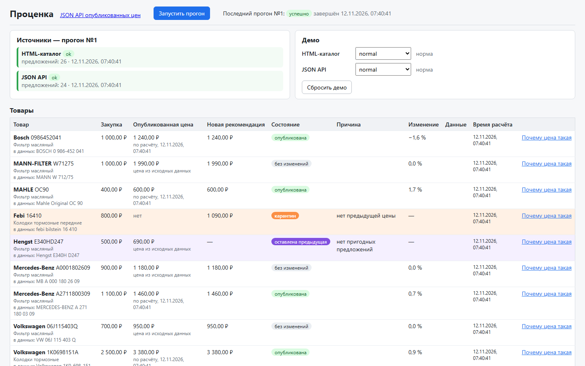
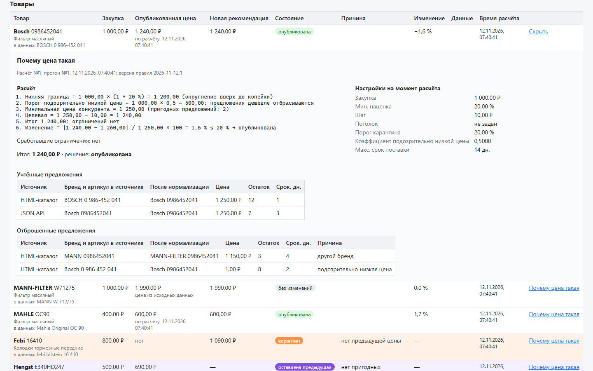
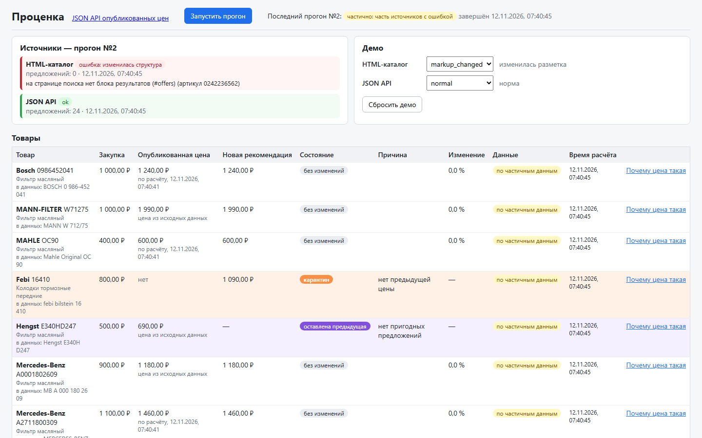
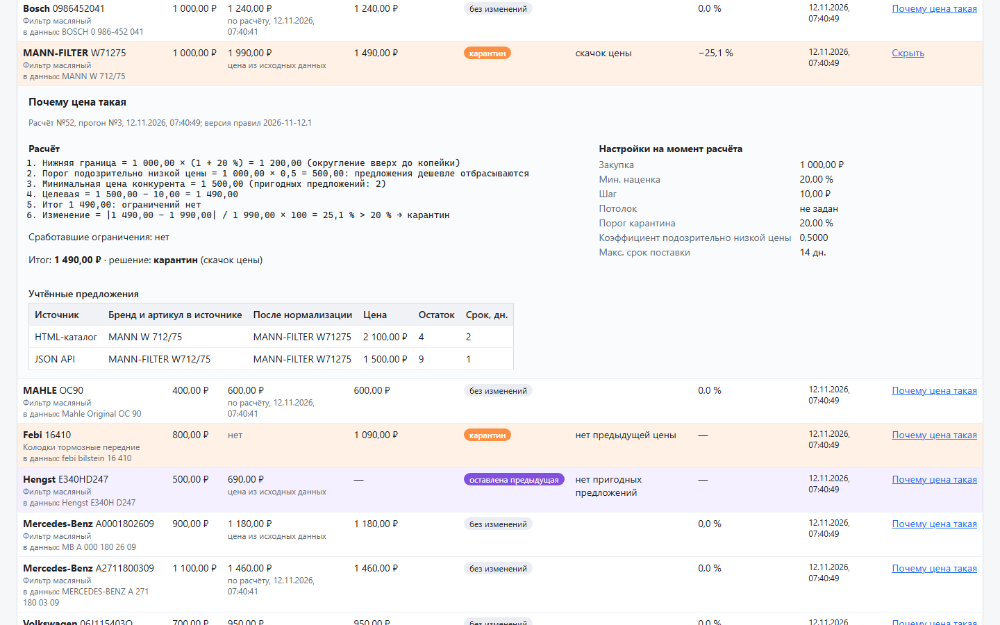

# Проценка — демо мини-платформы

Законченный цикл: сбор цен конкурентов → безопасный расчёт цены → объяснение результата менеджеру → выдача опубликованных цен через JSON API без Excel.

**Видео: будет добавлено.** (Двухминутное видео по [сценарию показа](#сценарий-показа) в цепочку реализации не входило — см. [отступления](#отступления-от-planmd).)

| | |
|---|---|
|  |  |
| Таблица после ручного прогона: A опубликована по 1 240 ₽ | «Почему цена такая» для A: формула, учтённые и отброшенные предложения |
|  |  |
| HTML-каталог: «изменилась структура», прогон частичный, цены — по JSON API | S в карантине: рекомендация 1 490 ₽ (−25,1 %), опубликованная остаётся 1 990 ₽ |

## Что это

Локальное демо для одного пользователя: 25 подготовленных товаров, два синтетических источника цен, один воркер. Спецификация — [plan.md](plan.md), журнал реализации — [docs/progress.md](docs/progress.md).

Два равных акцента:

- **Парсинг и его поломки.** Площадки меняют вёрстку и защиту, парсеры ломаются. Каждая поломка замечается, получает один из трёх типов — сеть, структура, блокировка — и никогда не превращается в цену 0 или «товара нет». Как разбирать поломку — [docs/runbook.md](docs/runbook.md).
- **Деньги и публикация.** Ошибка в коде — неверная цена у клиента. Деньги только `Decimal` / `NUMERIC(12,2)` / строки в JSON; наценка, округление, границы и карантин — по фиксированным правилам, у каждой цены есть объяснение «почему цена такая». Правила — [docs/pricing.md](docs/pricing.md).

## Запуск

Нужен только Docker Desktop (Docker Compose v2). Для проверок и скрипта приёмки дополнительно: [uv](https://docs.astral.sh/uv/) (сам поставит Python 3.13) и Node.js 24 с npm.

```sh
docker compose up --build -d --wait
```

Блоки команд в этом README и в [runbook](docs/runbook.md) написаны для POSIX-оболочки — на Windows запускайте их в Git Bash. Команды `docker compose`, `uv`, `npm` и `curl` без переменных окружения и `grep` работают и в PowerShell; варианты для PowerShell там, где синтаксис отличается, приведены рядом.

Команда собирает образы и ждёт, пока все 5 сервисов станут healthy: postgres, fake-sites, api, worker, nginx. Миграции и seed (25 товаров, 24 опубликованные цены) api выполняет при старте сам.

Экран: **http://127.0.0.1:8080**.

| Порт на хосте (только `127.0.0.1`) | Сервис | Переменная |
|---|---|---|
| 8080 | nginx: экран, `/api/` и `/health` проксируются на api | `NGINX_HOST_PORT` |
| 8000 | api напрямую (отладка) | `API_HOST_PORT` |
| 8001 | fake-sites: синтетические площадки и их управление | `FAKE_SITES_HOST_PORT` |
| 54329 | PostgreSQL 16 | `POSTGRES_HOST_PORT` |

Порты и учётные данные postgres меняются в `.env` (скопируйте [.env.example](.env.example)); `docker compose` читает `.env` сам. Расписание прогонов в compose выключено (`SCHEDULE_INTERVAL_SECONDS=0`), см. [ниже](#расписание-и-восстановление-после-остановки-воркера).

Сброс и остановка:

```sh
curl -X POST http://127.0.0.1:8080/api/demo/reset   # БД в состояние seed, оба источника в normal (то же — кнопка «Сбросить демо»)
docker compose exec api python -m app.db.reset      # сбросить только БД, без проверки активного прогона
docker compose down                                 # остановить; база остаётся в томе
docker compose down -v                              # остановить и удалить том с базой
```

`POST /api/demo/reset` отвечает 409, если прогон в очереди или выполняется: подождите его завершения и повторите.

## Сценарий показа

Товар **A** — Bosch 0986452041 (закупка 1 000 ₽, наценка 20 %, шаг 10 ₽, опубликован по 1 260 ₽). Товар **S** — MANN-FILTER W71275, контрольный для `price_spike` (закупка 1 000 ₽, опубликован по 1 990 ₽, порог карантина 20 %). Режимы источников переключаются в панели «Демо» справа вверху и действуют на следующий прогон.

| № | Что сделать на экране | Что увидеть |
|---|---|---|
| 1 | `docker compose up --build -d --wait`, открыть http://127.0.0.1:8080, при необходимости «Сбросить демо» | «Прогонов ещё не было»; таблица из 25 товаров, у A опубликована 1 260,00 ₽ «цена из исходных данных» |
| 2 | «Запустить прогон»; в строке A — «Почему цена такая» | прогон «успешно»; A: 1 240,00 ₽ «опубликована», −1,6 %. В раскрытии: «Целевая = 1 250,00 − 10,00 = 1 240,00», нижняя граница 1 200,00, отброшены `MANN 0986452041` — «другой бренд» и `Bosch 0 986 452 041` за 1,00 ₽ — «подозрительно низкая цена» |
| 3 | HTML-каталог → `markup_changed`, «Запустить прогон» | прогон «частично»; в «Источниках» HTML-каталог «ошибка: изменилась структура» с сообщением «на странице поиска нет блока результатов (#offers) …», JSON API ok; A 1 240,00 «без изменений», «по частичным данным» |
| 4 | HTML-каталог → `blocked`, «Запустить прогон»; открыть [docs/runbook.md](docs/runbook.md) | та же картина, причина другая: «ошибка: заблокирован», «доступ запрещён (страница капчи): HTTP 403 на /html/search …»; цены A и S не изменились |
| 5 | HTML-каталог → `normal`, JSON API → `price_spike`, «Запустить прогон»; в строке S — «Почему цена такая» | S «карантин», «скачок цены», рекомендация 1 490,00 ₽, −25,1 %; опубликованная — прежняя 1 990,00 ₽. Формула: «Изменение = \|1 490,00 − 1 990,00\| / 1 990,00 × 100 = 25,1 % > 20 % → карантин» |
| 6 | ссылка «JSON API опубликованных цен» (или `curl http://127.0.0.1:8080/api/published-prices`) | у S `"price": "1990.00"`, 1 490 в выдаче нет; у A `"1240.00"` |
| 7 | `uv run --directory backend pytest tests/unit/pricing/test_control_cases.py` | `control cases: 25 matched, 0 mismatched` |

После показа — «Сбросить демо»: каждый шаг снова воспроизводится.

Весь сценарий автоматически, через nginx, как экран (стек должен быть поднят):

```sh
uv run --directory backend python ../scripts/demo_scenario.py                      # по умолчанию http://127.0.0.1:8080
uv run --directory backend python ../scripts/demo_scenario.py --base-url http://127.0.0.1:8080
```

Скрипт печатает «ШАГ N … OK» с ключевыми числами (1240.00, 1490.00, −25.1, 1990.00, `control cases: …`), при первом расхождении — FAIL и код 1 (демо остаётся как есть, чтобы посмотреть на экране). Перед шагом 2 и после шага 7 он сбрасывает демо, поэтому запускается повторно.

### Расписание и восстановление после остановки воркера

Показываются отдельно от сценария. Расписание: прогон ставится, если нет активного и последний прогон любого источника запуска создан не позже интервала назад (на пустой таблице прогонов — сразу); решение принимается по БД.

```sh
SCHEDULE_INTERVAL_SECONDS=60 docker compose up -d worker   # пересоздать воркер с расписанием раз в 60 с
curl http://127.0.0.1:8080/api/status                      # latest_run.trigger = "schedule"
docker compose up -d worker                                # вернуть расписание в выключенное состояние
```

То же в PowerShell:

```powershell
$env:SCHEDULE_INTERVAL_SECONDS = "60"; docker compose up -d worker; Remove-Item Env:SCHEDULE_INTERVAL_SECONDS
(Invoke-RestMethod http://127.0.0.1:8080/api/status).latest_run.trigger   # schedule
docker compose up -d worker
```

Восстановление: прогон надолго остаётся running (JSON API отвечает 429 с `Retry-After` 10 с, это помещается в бюджет 30 с; весь прогон длится около 20 с), воркер перезапускается посреди прогона и при старте переводит его в failed с причиной `interrupted`. Следующий прогон начинается заново.

Перезапуск — **сразу**, как только `active_run.status = "running"`, и с коротким таймаутом остановки `-t 1`: на SIGTERM воркер не прерывает прогон, а выходит после текущей итерации. С обычным таймаутом Docker (10 с) прогон может успеть завершиться (`partial`) до того, как воркер будет убит, и восстанавливать будет нечего.

```sh
curl -X PUT http://127.0.0.1:8080/api/demo/modes/json_api -H 'content-type: application/json' -d '{"mode":"blocked","retry_after":10}'
curl -X POST http://127.0.0.1:8080/api/runs
curl http://127.0.0.1:8080/api/status               # active_run.status = "running"
docker compose restart -t 1 worker                  # сразу, пока прогон running
curl http://127.0.0.1:8080/api/status               # latest_run: failed, finish_reason "interrupted"
docker compose logs worker | grep interrupted       # "run was left running by a stopped worker: failed as interrupted"
curl -X POST http://127.0.0.1:8080/api/demo/reset   # демо и режимы — в исходное состояние
```

То же в PowerShell:

```powershell
Invoke-RestMethod -Method Put http://127.0.0.1:8080/api/demo/modes/json_api -ContentType 'application/json' -Body '{"mode":"blocked","retry_after":10}'
Invoke-RestMethod -Method Post http://127.0.0.1:8080/api/runs
(Invoke-RestMethod http://127.0.0.1:8080/api/status).active_run.status    # running
docker compose restart -t 1 worker
(Invoke-RestMethod http://127.0.0.1:8080/api/status).latest_run | Select-Object id, status, finish_reason
docker compose logs worker --no-log-prefix | Select-String interrupted
Invoke-RestMethod -Method Post http://127.0.0.1:8080/api/demo/reset
```

## API

Все пути — через nginx (`http://127.0.0.1:8080`) или напрямую на api (`:8000`). Схема — [backend/openapi.json](backend/openapi.json). Деньги — строки с двумя знаками (`"1240.00"`), время — ISO 8601 в UTC.

| Метод и путь | Что делает |
|---|---|
| `GET /health` | 200 `{"status":"ok"}`; 503 `{"status":"unavailable"}`, если БД не отвечает |
| `POST /api/runs` | поставить ручной прогон: 201 — новый, 200 — уже есть в очереди или выполняется (тот же `id`) |
| `GET /api/runs/{id}` | статус прогона и результаты источников |
| `GET /api/status` | `latest_run`, `active_run`, `last_finished_run` с источниками |
| `GET /api/products` | таблица экрана: закупка, опубликованная цена, последний расчёт |
| `GET /api/calculations/{id}` | «Почему цена такая»: предложения, причины, границы, формула |
| `GET /api/published-prices` | опубликованные цены — контракт для системы прайс-листов |
| `GET /api/demo/modes` | режимы обоих источников (прокси к fake-sites) |
| `PUT /api/demo/modes/{source}` | сменить режим: `{"mode": "markup_changed"}`, для `blocked` можно `"retry_after": 10` |
| `POST /api/demo/reset` | оба источника в `normal`, БД в состояние seed; 409 при активном прогоне |

### Контракт `GET /api/published-prices`

Минимальный контракт для системы прайс-листов (принимающую систему не строим): только опубликованные цены, их даты и идентификаторы расчётов. **Рекомендации из карантина и прочие неопубликованные рекомендации в выдачу не входят**: в таблицу опубликованных цен пишет только расчёт в состоянии «опубликована». Постраничной выдачи нет — для 25 товаров она не нужна.

```json
{
  "prices": [
    {
      "product_id": 1,
      "brand": "Bosch",
      "article": "0986452041",
      "name": "Фильтр масляный",
      "price": "1240.00",
      "published_at": "2026-11-12T04:40:01.149857Z",
      "calculation_id": 1
    },
    {
      "product_id": 2,
      "brand": "MANN-FILTER",
      "article": "W71275",
      "name": "Фильтр масляный",
      "price": "1990.00",
      "published_at": "2026-11-01T09:00:00Z",
      "calculation_id": null
    }
  ]
}
```

`brand` и `article` — нормализованные; `calculation_id` — расчёт, по которому опубликована цена (`null` у цены из исходных данных seed). Товара без опубликованной цены (Febi 16410, первая рекомендация уходит в карантин) в выдаче нет.

## Архитектура

| Сервис compose | Что делает |
|---|---|
| `postgres` | PostgreSQL 16, том `postgres-data` |
| `fake-sites` | две синтетические площадки: HTML-каталог (`/html/search`) и скрытый JSON API с сессионной cookie (`/json/`, `/json/api/offers`); режимы сбоев в памяти, управление `/control/modes` |
| `api` | FastAPI; при старте `alembic upgrade head` и seed |
| `worker` | `python -m app.worker`: восстановление прерванных прогонов, расписание, claim, execute |
| `nginx` | статика фронтенда (React + TypeScript + TanStack Query) и прокси `/api/`, `/health` на api |

Поток прогона:

1. `POST /api/runs` (или расписание) ставит прогон; частичный уникальный индекс допускает только один прогон в очереди или выполняемый, повторный запрос возвращает его же.
2. Воркер забирает прогон `SELECT … FOR UPDATE SKIP LOCKED` и переводит в running.
3. **Сбор без транзакции БД**: оба источника параллельно, с ограничением параллельности, таймаутами, повторами и бюджетом 30 с на источник. Источник возвращает либо предложения, либо ошибку одного из трёх типов.
4. **Транзакция записи**: результаты источников, предложения (одной пакетной вставкой), расчёт каждого товара по свежим предложениям этого прогона.
5. **Короткая транзакция публикации**: прогон завершается (succeeded / partial / failed) и расчёты в состоянии «опубликована» пишутся в `published_prices` через `INSERT … ON CONFLICT`. Если прогон уже не running (его прервали), ничего не публикуется.

Один источник упал — прогон partial, расчёт по второму с пометкой «по частичным данным». Оба упали — прогон failed, расчётов нет, опубликованные цены не меняются.

Логи api и worker — structlog, одна JSON-строка на запись в stdout с `run_id`, `source`, `product_id` (поиск — в [runbook](docs/runbook.md#логи)).

```
backend/app/api        FastAPI: эндпоинты, схемы, OpenAPI
backend/app/pricing    ядро расчёта: чистые функции, Decimal, нормализация, формула
backend/app/parsers    источники: HTML (selectolax), JSON API (сессия), повторы и бюджет
backend/app/worker     цикл воркера, выполнение прогона, heartbeat
backend/app/db         модели, миграции Alembic, seed, reset, очередь прогонов
backend/tests          unit и интеграционные тесты (PostgreSQL), control_cases.csv
fake_sites/            синтетические площадки с режимами сбоев (отдельный uv-проект)
frontend/              экран (Vite, React, TS); типы API генерируются из openapi.json
deploy/                compose.yaml, nginx
scripts/               demo_scenario.py — приёмка сценария показа
docs/                  pricing.md, runbook.md, progress.md, screenshots/
```

## Проверки

Из корня репозитория (PowerShell и Git Bash одинаково); интеграционные тесты идут на настоящем PostgreSQL из compose и падают, а не пропускаются, если он недоступен.

```sh
docker compose up -d --wait postgres
uv run --directory backend ruff check . ../scripts
uv run --directory backend ruff format --check . ../scripts
uv run --directory backend mypy
uv run --directory backend pytest
uv run --directory fake_sites ruff check
uv run --directory fake_sites ruff format --check
uv run --directory fake_sites mypy
uv run --directory fake_sites pytest
npm --prefix frontend ci
npm --prefix frontend run typecheck
npm --prefix frontend run lint
npm --prefix frontend test
npm --prefix frontend run build
npm --prefix frontend run gen:api:check
docker compose config --quiet
```

Подробности (переменные тестовой базы, регенерация OpenAPI и типов TS, запуск без контейнеров) — в [AGENTS.md](AGENTS.md).

## Ограничения

- **Источники синтетические.** Обе площадки — сервис `fake-sites` из этого репозитория с переключаемыми режимами сбоев; настоящие сайты конкурентов не опрашиваются. Режимы живут в памяти fake-sites и сбрасываются при его перезапуске.
- **Один воркер.** Прогон забирается `FOR UPDATE SKIP LOCKED`, но поддержка нескольких воркеров не заявляется и не проверяется.
- **Подтверждения карантина нет.** Рекомендация из карантина сама не публикуется: если рынок действительно сдвинулся, цена останется прежней до [расширения 1](plan.md#расширения--по-порядку) («Подтверждение карантина»). То же касается первой рекомендации товара без опубликованной цены.
- **Проверки на больших объёмах нет.** Предложения пишутся пакетной вставкой, опубликованные цены — через `ON CONFLICT`, но нагрузочных тестов нет; демо проверено на 25 товарах и двух источниках.
- Локальное демо для одного пользователя: авторизации нет, управляющие эндпоинты (`/api/demo/*`, `/control/*` fake-sites) открыты, порты опубликованы только на `127.0.0.1`. Учётные данные postgres по умолчанию — только для локального запуска.
- Расписание в поставляемом compose выключено (включается одной переменной, см. выше).

## Что сознательно отложено

Полный список и причины — [plan.md, «Что сознательно отложено»](plan.md#что-сознательно-отложено): пул прокси с ротацией, решатель капчи, circuit breaker; отсечение выбросов по медиане и IQR; TTL предложений; IMAP/SMTP, Excel, загрузка файлов, рассылки; графики, дашборд, редактор правил; постраничная выдача в JSON API; несколько воркеров и распределённый планировщик.

## Расширения

По порядку, только после ядра — [plan.md, «Расширения»](plan.md#расширения--по-порядку). Ни одно не реализовано.

1. Подтверждение карантина.
2. Selenium: третий источник с ценами, подгружаемыми JS.
3. Команда сверки с выгрузкой из старой системы.
4. CI (GitHub Actions).
5. Развёртывание на VPS с закрытыми управляющими эндпоинтами.

## Отступления от plan.md

Подробно — в [docs/progress.md](docs/progress.md), в разделах «Отступления от plan.md» каждого шага и в «Итоге демо».

- **Повторы — явным циклом, без tenacity** (`backend/app/parsers/http.py`): решение о повторе зависит от ответа (403 / 429 / 5xx), пауза — от `Retry-After` и остатка бюджета, а часы внедряются, чтобы тесты проверяли «без ожидания».
- **Расписание в compose выключено по умолчанию** (`SCHEDULE_INTERVAL_SECONDS=0`, в приложении 600 с): на пустой таблице прогонов (первый запуск, каждый сброс) прогон по расписанию опубликовал бы A раньше ручного шага 2 сценария.
- **Видео нет**: в цепочку реализации оно не входило, место в начале README оставлено.
- Шаг 1 сценария — `docker compose up --build -d --wait` вместо `docker compose up --build`: в фоне и с ожиданием готовности всех сервисов.
